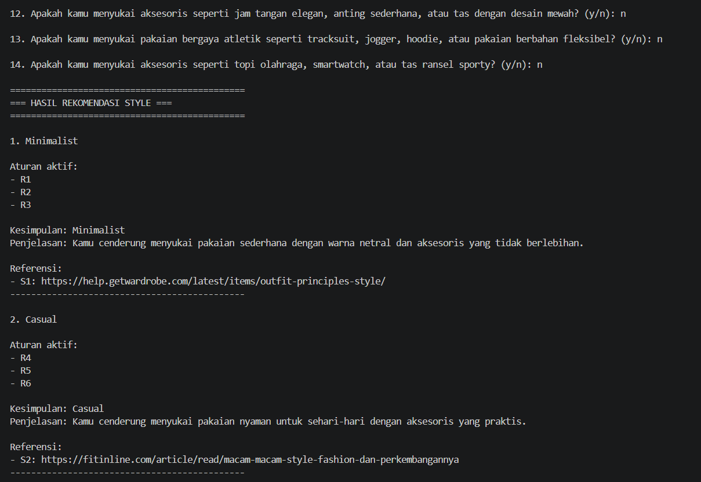
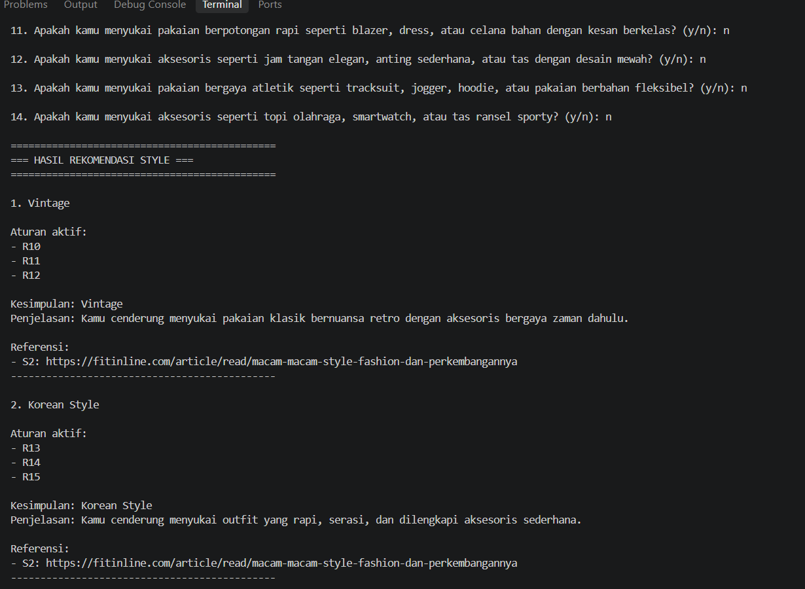
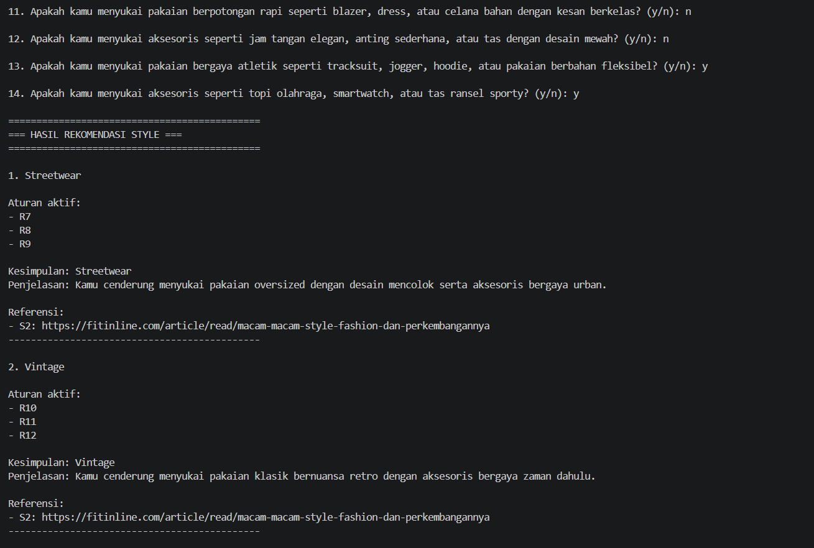
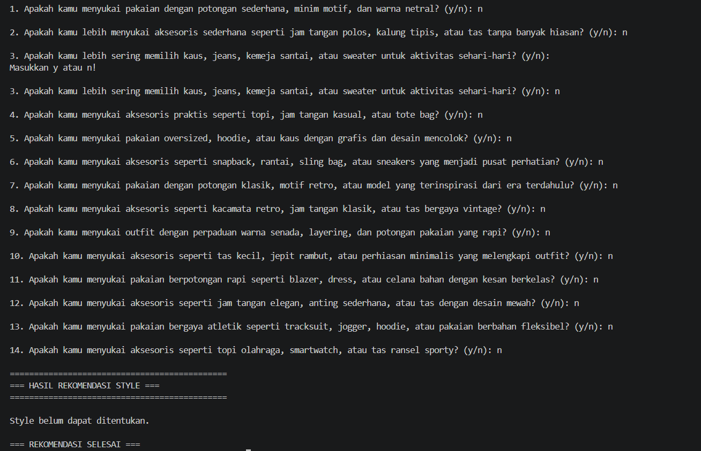

# SISTEM PAKAR REKOMENDASI STYLE FASHION

## 1. Identitas

- **Nama:** Evalinda Gracia Faozi
- **NIM:** F1D02510048

## 2. Topik dan Cara Menjalankan Program

Program ini merupakan sistem pakar sederhana yang digunakan untuk memberikan rekomendasi style fashion berdasarkan karakteristik pakaian dan aksesori yang disukai pengguna.

Sistem menyediakan tujuh kategori style fashion, yaitu Minimalist, Casual, Streetwear, Vintage, Korean Style, Elegant, dan Sporty. Pengguna akan menjawab 14 pertanyaan dengan pilihan Ya atau Tidak. Jawaban tersebut kemudian diproses menggunakan metode Forward Chaining untuk menghasilkan maksimal dua rekomendasi style yang sesuai.

**Informasi program:**

- Bahasa pemrograman: Python
- Versi Python: 3.12
- File program utama: `main.py`
- File aturan: `aturan.json`

**Cara menjalankan program:**

1. Pastikan Python sudah terinstal di perangkat.
2. Buka folder proyek melalui Visual Studio Code atau terminal.
3. Pastikan file `main.py` dan `aturan.json` berada dalam folder yang sama.
4. Jalankan perintah berikut:

```bash
python main.py
```

## 3. Daftar Sumber dan Tabel Aturan

### A. Sumber Pengetahuan

Sumber pengetahuan yang digunakan dalam penyusunan aturan sistem pakar ini adalah sebagai berikut.

| Kode | Judul | Penerbit | URL | Tanggal Akses |
|---|---|---|---|---|
| S1 | Outfit Principles & Style | GetWardrobe | https://help.getwardrobe.com/latest/items/outfit-principles-style/ | 14 November 2026 |
| S2 | Macam-Macam Style Fashion dan Perkembangannya | Fitinline | https://fitinline.com/article/read/macam-macam-style-fashion-dan-perkembangannya | 14 November 2026 |

### B. Tabel Aturan

Sistem menggunakan 21 aturan yang disusun dengan pola IF-THEN. Setiap kategori style memiliki tiga aturan, yaitu dua aturan untuk menghasilkan fakta karakteristik pakaian dan aksesori, serta satu aturan untuk menghasilkan kesimpulan akhir.

| Kode | Kondisi IF | Kesimpulan THEN | Sumber |
|---|---|---|---|
| R1 | Jawaban 1 = Ya | pakaian_minimalis | S1 |
| R2 | Jawaban 2 = Ya | aksesoris_minimalis | S1 |
| R3 | pakaian_minimalis DAN aksesoris_minimalis | Minimalist | S1 |
| R4 | Jawaban 3 = Ya | pakaian_casual | S2 |
| R5 | Jawaban 4 = Ya | aksesoris_casual | S2 |
| R6 | pakaian_casual DAN aksesoris_casual | Casual | S2 |
| R7 | Jawaban 5 = Ya | pakaian_streetwear | S2 |
| R8 | Jawaban 6 = Ya | aksesoris_streetwear | S2 |
| R9 | pakaian_streetwear DAN aksesoris_streetwear | Streetwear | S2 |
| R10 | Jawaban 7 = Ya | pakaian_vintage | S2 |
| R11 | Jawaban 8 = Ya | aksesoris_vintage | S2 |
| R12 | pakaian_vintage DAN aksesoris_vintage | Vintage | S2 |
| R13 | Jawaban 9 = Ya | pakaian_korean | S2 |
| R14 | Jawaban 10 = Ya | aksesoris_korean | S2 |
| R15 | pakaian_korean DAN aksesoris_korean | Korean Style | S2 |
| R16 | Jawaban 11 = Ya | pakaian_elegant | S2 |
| R17 | Jawaban 12 = Ya | aksesoris_elegant | S2 |
| R18 | pakaian_elegant DAN aksesoris_elegant | Elegant | S2 |
| R19 | Jawaban 13 = Ya | pakaian_sporty | S2 |
| R20 | Jawaban 14 = Ya | aksesoris_sporty | S2 |
| R21 | pakaian_sporty DAN aksesoris_sporty | Sporty | S2 |

Keterangan: Aturan pertama dan kedua pada setiap kategori menghasilkan fakta karakteristik pakaian dan aksesori berdasarkan jawaban pengguna. Selanjutnya, aturan ketiga menggabungkan kedua fakta tersebut untuk menghasilkan kesimpulan berupa style fashion. Setiap aturan juga dilengkapi dengan kode sumber pengetahuan yang digunakan.

## 4. Metode yang Digunakan

Metode yang digunakan dalam program ini adalah **Forward Chaining (FC)**. Metode ini merupakan metode penalaran yang dimulai dari fakta awal, kemudian mencocokkan fakta tersebut dengan aturan yang tersedia hingga menghasilkan suatu kesimpulan.

Metode Forward Chaining dipilih karena sistem rekomendasi fashion ini memperoleh fakta dari jawaban pengguna terhadap 14 pertanyaan. Fakta tersebut kemudian digunakan untuk menjalankan aturan secara bertahap sampai ditemukan kesimpulan yang sesuai.

Sebagai contoh, ketika pengguna menjawab Ya pada pertanyaan nomor 1, sistem akan menghasilkan fakta `pakaian_minimalis` melalui aturan R1. Jika pengguna juga menjawab Ya pada pertanyaan nomor 2, sistem akan menghasilkan fakta `aksesoris_minimalis` melalui aturan R2. Setelah kedua fakta tersebut tersedia, aturan R3 akan dijalankan dan menghasilkan kesimpulan Minimalist.

Proses pemeriksaan aturan dilakukan secara berulang selama masih terdapat aturan yang dapat dijalankan. Apabila tidak ada aturan baru yang terpenuhi, proses penalaran akan dihentikan.

Sistem membatasi hasil rekomendasi maksimal dua style. Apabila terdapat lebih dari dua kesimpulan yang memenuhi aturan, sistem akan mengambil dua kesimpulan pertama berdasarkan urutan aturan dalam file `aturan.json`. Jika tidak ada karakteristik yang memenuhi aturan secara lengkap, sistem akan menampilkan pesan bahwa style belum dapat ditentukan.

## 5. Pengujian Program

Pengujian dilakukan menggunakan empat kasus untuk mengetahui kemampuan sistem dalam memberikan rekomendasi berdasarkan jawaban pengguna.

### A. Kasus 1 – Rekomendasi Minimalist dan Casual

Pada pengujian pertama, pengguna memberikan jawaban Ya pada pertanyaan nomor 1, 2, 3, dan 4. Jawaban tersebut memenuhi karakteristik pakaian dan aksesori untuk style Minimalist dan Casual. Sistem kemudian menghasilkan kedua style tersebut sebagai rekomendasi.

**Hasil program:**



### B. Kasus 2 – Rekomendasi Vintage dan Korean Style

Pada pengujian kedua, pengguna memberikan jawaban Ya pada pertanyaan nomor 7, 8, 9, dan 10. Kedua karakteristik untuk style Vintage dan Korean Style terpenuhi. Sistem kemudian menghasilkan kedua style tersebut sebagai rekomendasi.

**Hasil program:**



### C. Kasus 3 – Rekomendasi Streetwear dan Vintage

Pada pengujian ketiga, pengguna memberikan jawaban Ya pada pertanyaan nomor 5, 6, 7, dan 8. Jawaban tersebut memenuhi karakteristik pakaian dan aksesori untuk Streetwear serta Vintage. Sistem kemudian menghasilkan kedua style tersebut sebagai rekomendasi.

**Hasil program:**



### D. Kasus 4 – Tidak Ada Rekomendasi

Pada pengujian keempat, pengguna memberikan jawaban Tidak pada seluruh pertanyaan. Karena tidak ada karakteristik yang memenuhi aturan secara lengkap, sistem tidak menghasilkan rekomendasi dan menampilkan pesan "Style belum dapat ditentukan."

**Hasil program:**



Selain pengujian hasil rekomendasi, program juga melakukan validasi input. Apabila pengguna memasukkan jawaban selain `y` atau `n`, program akan menampilkan pesan kesalahan dan meminta pengguna memasukkan jawaban kembali.

## 6. Batas Keberlakuan Sistem

Sistem pakar ini menggunakan pengetahuan mengenai karakteristik style fashion yang diperoleh dari sumber GetWardrobe dan Fitinline. Sistem hanya berlaku untuk memberikan rekomendasi berdasarkan tujuh kategori style yang telah ditentukan, yaitu Minimalist, Casual, Streetwear, Vintage, Korean Style, Elegant, dan Sporty, dengan kondisi pengguna menjawab 14 pertanyaan mengenai karakteristik pakaian dan aksesori yang disukai. Hasil rekomendasi digunakan sebagai saran untuk membantu mengenali kecenderungan style fashion seseorang, bukan sebagai keputusan akhir atau ketentuan mutlak dalam memilih gaya berpakaian karena pilihan tersebut tetap bergantung pada selera dan kenyamanan masing-masing individu.

## 7. Penggunaan Alat Bantu AI

Dalam pengerjaan proyek ini, AI digunakan sebagai alat bantu untuk membantu penulisan kode Python yang error, membantu penyusunan dan penjelasan untuk README serta metode apa yang digunakan.
